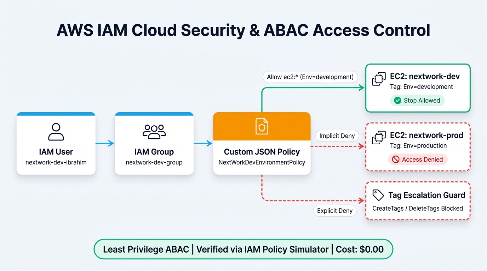
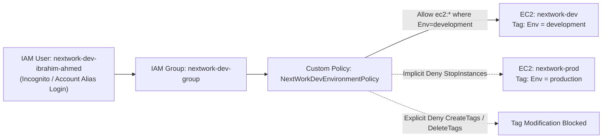

<div align="center">

# AWS IAM Cloud Security & ABAC Access Control


**Attribute-Based Access Control (ABAC) in AWS IAM granting full EC2 control on `Env: development` resources while protecting `Env: production` instances.**

</div>

---

## 1. Architecture Overview





> [!IMPORTANT]
> **Key Design Decision:** Separating permissions by resource tags (`ec2:ResourceTag/Env = development`) and explicitly denying `ec2:CreateTags` and `ec2:DeleteTags` prevents privilege escalation where a user could re-tag a production server as `development`.

---

## 2. Problem & Solution

| Aspect | Detail |
| :--- | :--- |
| **Problem** | Granting broad `ec2:*` permissions to a developer or intern risks accidental or unauthorized changes to production EC2 instances. |
| **Solution** | Created `NextWorkDevEnvironmentPolicy` using tag-based IAM conditions (`ec2:ResourceTag/Env`) attached to `nextwork-dev-group` and user `nextwork-dev-ibrahim-ahmed`. |
| **Security Boundary** | `ec2:*` is allowed only on `Env: development`; `ec2:Describe*` is read-only across instances; `ec2:CreateTags` and `ec2:DeleteTags` are explicitly denied. |

---

## 3. Tech Stack
- **Cloud:** Amazon Web Services (AWS IAM, Amazon EC2, IAM Policy Simulator)
- **Access Control:** Custom IAM JSON Policy (`NextWorkDevEnvironmentPolicy`), ABAC Resource Tagging (`Env: development` / `Env: production`)
- **Identity Management:** IAM User Group (`nextwork-dev-group`), IAM User (`nextwork-dev-ibrahim-ahmed`), AWS Account Alias

---

## 4. Implementation Steps (Summary)
1. Launched two Amazon EC2 instances tagged `Env: development` (`nextwork-dev`) and `Env: production` (`nextwork-prod`).
2. Authored the custom JSON policy `NextWorkDevEnvironmentPolicy` using `ec2:ResourceTag/Env` conditions and explicit tag-modification `Deny` rules.
3. Created IAM User Group `nextwork-dev-group`, attached `NextWorkDevEnvironmentPolicy`, and onboarded IAM User `nextwork-dev-ibrahim-ahmed` into the group.
4. Configured an AWS Account Alias for sign-in and validated boundaries with both the IAM Policy Simulator and a live Incognito session.
5. Cleaned up lab resources by terminating `nextwork-dev` & `nextwork-prod` and deleting the test IAM group and user.

<details>
<summary><b>Click to expand Custom JSON Policy (NextWorkDevEnvironmentPolicy)</b></summary>

```json
{
    "Version": "2012-10-17",
    "Statement": [
        {
            "Effect": "Allow",
            "Action": "ec2:*",
            "Resource": "*",
            "Condition": {
                "StringEquals": {
                    "ec2:ResourceTag/Env": "development"
                }
            }
        },
        {
            "Effect": "Allow",
            "Action": "ec2:Describe*",
            "Resource": "*"
        },
        {
            "Effect": "Deny",
            "Action": [
                "ec2:DeleteTags",
                "ec2:CreateTags"
            ],
            "Resource": "*"
        }
    ]
}
```

</details>

---

## 5. Verification & Results
- **Live Access Testing (Incognito Session):**
  - `nextwork-dev` (`Env: development`): Successfully stopped the instance (`Stopping` state).
  - `nextwork-prod` (`Env: production`): Attempted to stop the instance → triggered **Access Denied**.
- **IAM Policy Simulator Evaluation:**
  - `StopInstances` with `ec2:ResourceTag/Env = development` → **Allowed**.
  - `DeleteTags` → **Denied** (enforcing tag preservation).
- **NextWork Project Certificate / Verification:** [View NextWork Project](https://nextwork.ai/hemaa/docs/51a5fd24-7458-58a6-8653-9b90119a0e4a)

---

## 6. Troubleshooting & Fixes
- **Issue:** Without explicit tag-modification denials, a developer with `ec2:*` on `Env: development` could attempt to bypass isolation by modifying instance tags.
- **Root Cause & Fix:** Added an explicit `Deny` statement for `ec2:CreateTags` and `ec2:DeleteTags` on `Resource: *` and verified both `StopInstances` on `nextwork-prod` (`Implicit Deny`) and `DeleteTags` (`Explicit Deny`) return **Access Denied**.

---

## 7. Cost & Teardown Verification ($0.00)
- [x] Both test EC2 instances (`nextwork-dev`, `nextwork-prod`) terminated after verification.
- [x] Temporary IAM User (`nextwork-dev-ibrahim-ahmed`) and IAM Group (`nextwork-dev-group`) deleted (`$0.00` AWS spend).

---

## 8. Key Engineering Takeaways
- **ABAC Scales Cleanly:** Tag-based IAM policies automatically cover newly created `development` instances without rewriting policies per instance ID.
- **Guard Tag Integrity:** ABAC is only secure when users are explicitly blocked from modifying the tags (`CreateTags` / `DeleteTags`) used in the policy condition.
